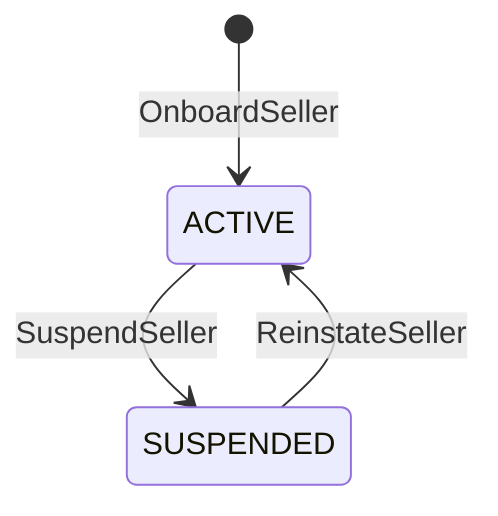
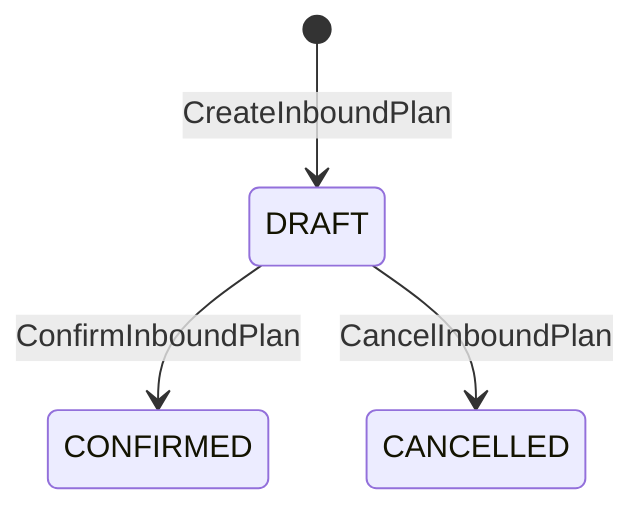
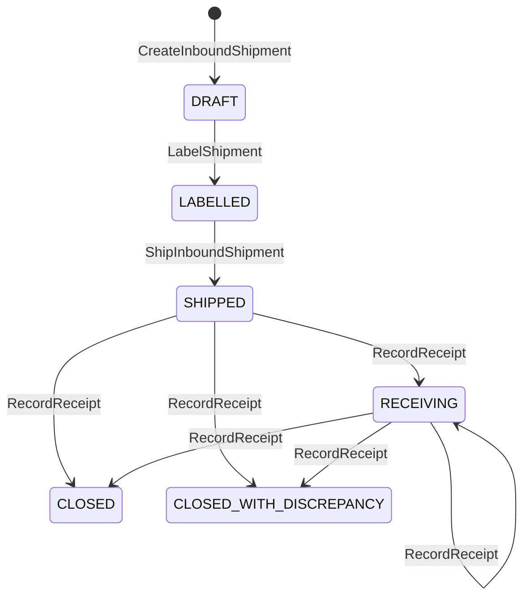

# Aggregate Design Canvas

Following the ddd-crew [Aggregate Design Canvas v1.1](https://github.com/ddd-crew/aggregate-design-canvas). Three aggregate
roots: **SellerAccount**, **InboundPlan** and **InboundShipment** (with the **Carton** entity). Go packages:
`internal/domain/seller`, `internal/domain/inboundplan` and `internal/domain/inboundshipment`, with the read-model value
types in `internal/domain/network` and the GS1 value objects in `internal/domain/shared/gs1`. Each aggregate is rebuilt
from a `Snapshot` by `Restore`, which re-validates every invariant, and carries an optimistic-concurrency `version`
(`409 concurrent-update` on a lost race). Decisions: [ADR 0002](/docs/adr/0002-aggregates-and-invariants).

## SellerAccount

**Description.** A seller organisation and the owner of the stock it sends. Identified by `sellerId`; `ownerRef` equals it.

Source: `internal/domain/seller/seller.go`.

| Invariant | Error |
| --- | --- |
| `sellerId` is unique (1 to 64 characters of `A-Z a-z 0-9 . _ -`) | `ErrSellerExists` |
| `name` is non-blank, trimmed, at most 120 characters; a suspension reason at most 200 | `ErrValidation` |
| A suspended seller creates no plan, shipment or carton and ships nothing | `ErrSellerSuspended` |

Suspending a suspended seller and reinstating an active one are no-ops that raise no event.

**Commands:** `OnboardSeller`, `SuspendSeller`, `ReinstateSeller`.
**Events:** `SellerOnboarded`, `SellerSuspended`, `SellerReinstated`.
**Throughput:** rare. **Size:** tens to thousands.

## InboundPlan

**Description.** What a seller intends to send to one node, in eaches, and how it will pack it. Value objects:
`PackingOption(INDIVIDUAL|CASE_PACKED)`, `Line{catalogItemId, gtin, qtyEaches}`.

Source: `internal/domain/inboundplan/plan.go`.

| Invariant | Error |
| --- | --- |
| Destination node is `ACTIVE` with the INBOUND capability, when the plan is created and when it is confirmed | `ErrNodeCannotReceive` |
| The seller is `ACTIVE` when the plan is created and confirmed | `ErrSellerSuspended` |
| 1 to 500 lines, one per catalogue item; every line names a `catalogItemId`, a valid non-variable-measure GTIN and `qtyEaches` from 1 to 2147483647 | `ErrValidation` |
| Only a `DRAFT` plan is confirmed or cancelled; a shipment needs a `CONFIRMED` plan | `ErrIllegalTransition` |

Whether the item is live is not checked (no `CatalogItemCreated` or `CatalogItemDiscontinued` is consumed), nor is a
`CASE_PACKED` line checked against the packaging view at plan time: that is enforced on `AddCarton`.

**Commands:** `CreateInboundPlan`, `ConfirmInboundPlan`, `CancelInboundPlan`.
**Events:** `InboundPlanConfirmed`. Cancelling raises no event.
**Throughput:** low to medium. **Size:** one row plus its lines (JSONB).

## InboundShipment and Carton

**Description.** One physical consignment of a plan to one node. The `Carton` entity is one SSCC logistic unit with its
contents. Value objects: `SSCC`, `GTIN`, `Kind(HOMOGENEOUS_CASE|MIXED)`,
`Content{catalogItemId, gtin, qtyEaches, lot?, expiry?}`, `ReceiptStatus(RECEIVED|MISSING|UNEXPECTED|DAMAGED)`.

Source: `internal/domain/inboundshipment/{shipment,carton,receipt}.go`.

| Invariant | Error |
| --- | --- |
| A `HOMOGENEOUS_CASE` carton holds exactly one item, one GTIN and one quantity; in a `CASE_PACKED` plan every carton is one | `ErrCasePackNotUniform` |
| The carton's `qtyEaches` equals `unitsPerPack` of an active CASE level with this GTIN in `catalog_pack_levels` | `ErrCaseQtyMismatchesGtin` |
| Carton gross weight within the node's `maxCartonWeightG` (when declared) | `ErrCartonOverweight` |
| Carton dimensions fit the node's `maxCartonDimsMm` in some orientation (when declared) | `ErrCartonOversize` |
| An SSCC is unique in the shipment and network-wide (`sscc_registry`) | `ErrSsccNotUnique` |
| An SSCC (and a `parentSscc`) has 18 digits and a valid mod-10 check digit | `ErrInvalidSscc` |
| Each item is on the plan and the eaches over the plan's shipments do not exceed the plan line; a single-shipment plan must match every line exactly at labelling | `ErrCartonContentsMismatchPlan` |
| Node able to receive when the shipment is created, labelled and shipped; a pallet (`parentSscc`) needs `acceptsPallets` not false | `ErrNodeCannotReceive` |
| Seller `ACTIVE` when the shipment is created, cartons added, labelled and shipped | `ErrSellerSuspended` |
| No ship without every carton sealed by labelling | `ErrShipmentNotLabelled` |
| At most 1000 cartons, 100 content lines per carton, lot at most 20 characters | `ErrValidation` |
| A receipt closes nothing twice: the first answer for a carton is final and a receipt for a closed shipment is a no-op | none |

**Commands:** `CreateInboundShipment`, `AddCarton`, `LabelShipment`, `ShipInboundShipment`, and `RecordReceipt` (invoked by
the consumer use case `ApplyInboundReceipt`).
**Events:** `InboundShipmentLabelled`, `InboundShipmentShipped`, `InboundShipmentReceived`,
`InboundDiscrepancyRecorded`, `SellerComplianceViolationRecorded`.
**Throughput:** medium; cartons dominate. **Size:** one row per shipment, its cartons and unexpected SSCCs in JSONB
columns, retained for audit.

An aggregate this size is a consistency choice: carton checks need the whole carton set (uniform quantity, plan totals),
so the cartons are children, not aggregates. A shipment of thousands of cartons is the cost; splitting it into several
shipments of one plan is the relief valve (the plan accepts several shipments).

## Read models

| Read model | Table | Fed by |
| --- | --- | --- |
| `NodeInboundView` | `node_inbound_views` | `NodeRegistered`, `NodeOperationalProfileDeclared`, `NodeActivated`, `NodeSuspended`, `NodeRetired` |
| `CatalogPackagingView` | `catalog_pack_levels` | `CatalogItemPackagingDeclared`, `CatalogItemPackLevelRetired` |
| Seller scorecard | `seller_scorecard_receipts`, `seller_scorecard_occurrences` | No event: this service's own facts (one row per closed shipment, one per discrepancy or violation), written in the transaction of each applied receipt; read by `GET /sellers/{sellerId}/scorecard` ([ADR 0005](/docs/adr/0005-seller-compliance-scorecard)) |
