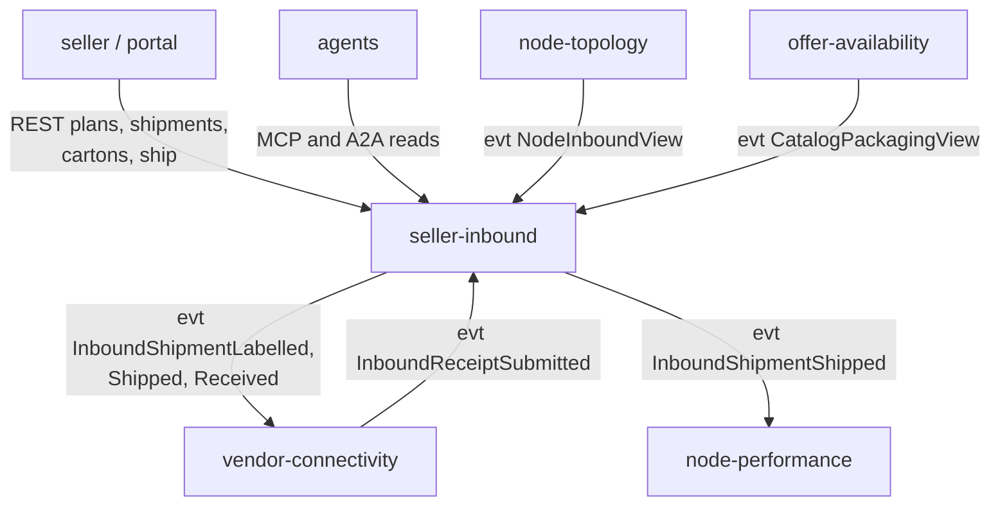

# Bounded Context Canvas

Following the ddd-crew [Bounded Context Canvas](https://github.com/ddd-crew/bounded-context-canvas).

Source: `internal/adapters/inbound/{http,kafka,mcp,a2a}`, `internal/adapters/outbound/kafka/encoder.go`,
`apis/asyncapi.yaml`.

## 1. Name

Seller Inbound (`seller-inbound`, `SI`), tier `partner`, Supporting.

## 2. Purpose

Let a seller plan, pack, label and ship stock to a vendor node, and close each shipment from the vendor's carton-level
receipt, with eaches as the ledger unit and the seller as owner of the stock.

## 3. Strategic classification

| Axis | Value |
| --- | --- |
| Domain | Supporting |
| Business model | Supply enabler |
| Evolution | Custom-built |

See [Subdomain classification](/docs/ddd/subdomain-classification).

## 4. Domain roles

Execution (inbound plans and shipments), Gateway for sellers (Open Host Service), Enforcer (carton and label compliance
at pack time; the receipt side only records).

## 5. Inbound communication

| Sender | Type | Message | Channel | Relationship |
| --- | --- | --- | --- | --- |
| seller / seller portal | command | `OnboardSeller` | REST `POST /sellers` | OHS |
| network partner managers | command | `SuspendSeller`, `ReinstateSeller` | REST `POST /sellers/{sellerId}:suspend`, `:reinstate` | UI |
| seller / seller portal | command | `CreateInboundPlan`, `ConfirmInboundPlan`, `CancelInboundPlan` | REST `POST /inbound-plans`, `:confirm`, `:cancel` | OHS |
| seller / seller portal | command | `CreateInboundShipment`, `AddCarton`, `LabelShipment`, `ShipInboundShipment` | REST `POST /inbound-plans/{planId}/shipments`, `POST /inbound-shipments/{shipmentId}/cartons`, `:label`, `:ship` | OHS |
| seller / seller portal | query | `GetInboundPlan`, `GetInboundShipment`, `GetLabels` | REST `GET /inbound-plans/{planId}`, `GET /inbound-shipments/{shipmentId}`, `.../labels` | OHS |
| seller / seller portal, network partner managers | query | `GetSellerScorecard` (informational) | REST `GET /sellers/{sellerId}/scorecard?window=7d` or `30d` | OHS |
| agents | query | the four reads above | MCP `get_inbound_plan`, `get_inbound_shipment`, `get_shipment_labels`, `get_seller_scorecard`; A2A skills `seller_compliance`, `inbound_status` | read-only, unauthenticated |
| `vendor-connectivity` | event | `InboundReceiptSubmitted` | Kafka `retailnetwork.vendor-connectivity.events` | Customer/Supplier |
| `node-topology` | event | `NodeRegistered`, `NodeOperationalProfileDeclared`, `NodeActivated`, `NodeSuspended`, `NodeRetired` | Kafka `retailnetwork.node-topology.events` | Conformist |
| `offer-availability` | event | `CatalogItemPackagingDeclared`, `CatalogItemPackLevelRetired` | Kafka `retailnetwork.offer-availability.events` | Conformist |

All write routes take an `Idempotency-Key`. No authentication, as in every other context of the fleet.

## 6. Outbound communication

| Message | Type | Consumers |
| --- | --- | --- |
| `SellerOnboarded`, `SellerSuspended`, `SellerReinstated` | event | analytics only |
| `InboundPlanConfirmed` | event | analytics only |
| `InboundShipmentLabelled`, `InboundShipmentReceived` | event | vendor-connectivity |
| `InboundShipmentShipped` | event | vendor-connectivity, node-performance |
| `InboundDiscrepancyRecorded`, `SellerComplianceViolationRecorded` | event | analytics only |

This context makes **no synchronous call** to any sibling.

## 7. Ubiquitous language

See [Ubiquitous language](/docs/ddd/ubiquitous-language).

## 8. Business decisions

See [Introduction](/docs/overview/introduction#business-rules-in-one-place) and [Use cases](/docs/ddd/use-cases). The
rules as policies, named in the model: `SsccIssuance`, `NodeMustBeAbleToReceive`, `OwnerSegregation`,
`ReceiveOnVendorReceipt`, `RecordDiscrepancies`. In code: `requireNode` and `Node.CanReceive` (node able to receive),
`addWithSSCC` and `sscc.Issuer` (SSCC issuance), `ApplyInboundReceipt` and `Shipment.RecordReceipt` (receipt and
discrepancies).

## 9. Assumptions

- A node's inbound limits and an item's packaging hierarchy reach this context as events before a seller plans against
  them; a cold read model refuses (`node-cannot-receive`, `case-qty-mismatches-gtin`) rather than guesses.
- The vendor receives the cartons and reports each SSCC it saw. An SSCC the vendor did not report is `MISSING` only when
  a receipt says so.
- The assumptions the model left open are settled in [ADR 0002](/docs/adr/0002-aggregates-and-invariants) (its numbered
  assumptions, for example A3 for repeated suspend, A5 for SSCC issuance, A8 for unmanifested cartons).

## 10. Verification metrics

Built: the Tier-2 counter `seller_inbound.shipment.shipped` (attribute `outcome` `shipped` or `rejected`, `reason` the
problem slug; [ADR 0008](/docs/adr/0008-fleet-observability-standard)) and the per-seller scorecard
(`receiptAccuracyRate`, `discrepancyRatePerShipment`, `discrepanciesByKind`, `complianceViolations`, `complianceTier`;
[ADR 0005](/docs/adr/0005-seller-compliance-scorecard)). Not built: share of cartons whose SSCC was network-issued; time
from `SHIPPED` to the first receipt; share of case-packed cartons refused at `AddCarton`.

## 11. Open questions

From the network gap register (G41 to G55, in IQVO/warehouse-docs): commingling, compliance scoring beyond the
informational scorecard (nothing acts on its tier), inbound freight, EDI adapters, FEFO, who creates owner-scoped
listings from received stock, pallets and inner packs.
