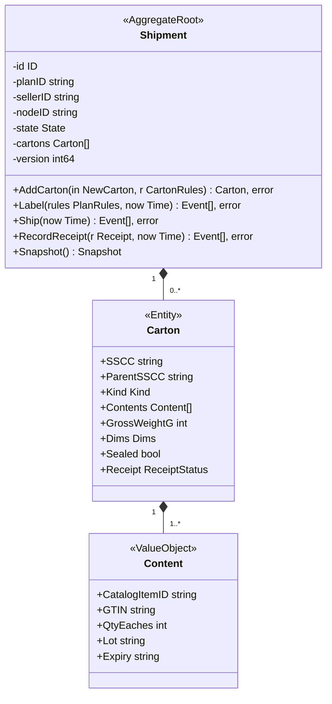
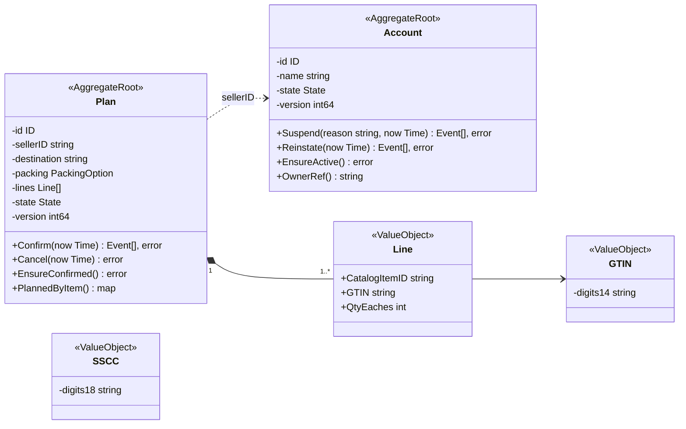
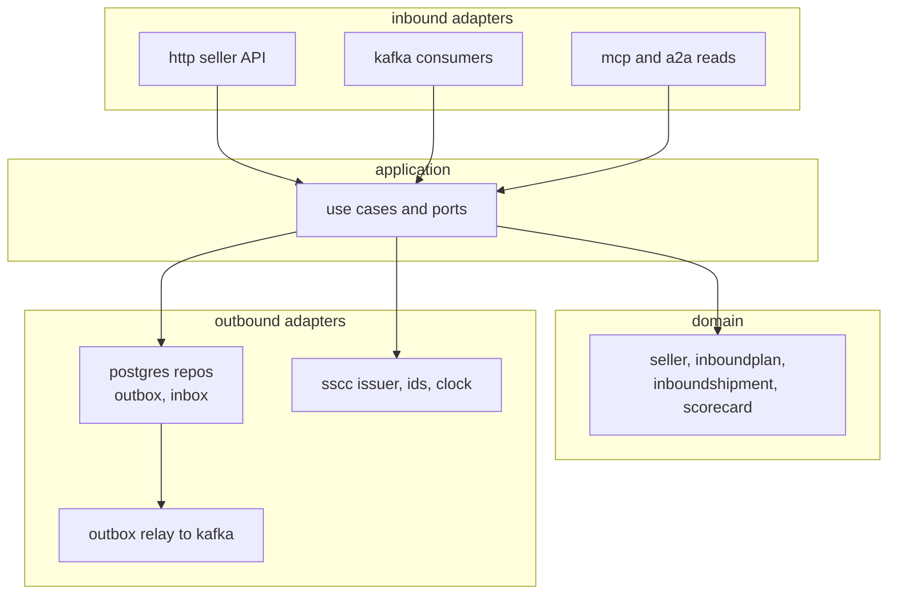

# Class Diagram

UML class diagrams of the domain model. Fields are unexported (`-`), methods exported (`+`); only methods that exist in
the code are listed. The packages are `internal/domain/seller` (`Account`), `internal/domain/inboundplan` (`Plan`),
`internal/domain/inboundshipment` (`Shipment`, `Carton`, `Receipt`), `internal/domain/network` (the read-model value
types), `internal/domain/scorecard` (the informational scorecard) and `internal/domain/shared/gs1` (`GTIN`, `SSCC`).
The terms are mapped on [Ubiquitous language](/docs/ddd/ubiquitous-language).

## 1. InboundShipment aggregate

Source: `internal/domain/inboundshipment/{shipment,carton,receipt}.go`. `Restore(Snapshot)` rebuilds the aggregate and
re-validates it. A new shipment starts empty and `DRAFT`; cartons are added one at a time, so the diagram says `0..*`.

## 2. Plan, seller and identifiers

Source: `internal/domain/seller/seller.go`, `internal/domain/inboundplan/plan.go`, `internal/domain/shared/gs1`. The GTIN
parser accepts the short GS1 forms, checks the mod-10 digit and returns the 14-digit form; the SSCC parser needs exactly
18 digits with a valid mod-10 digit. A client-supplied check digit is never trusted.

## 3. Hexagonal layout

Source: `internal/adapters/{inbound,outbound}`, `internal/application`; the dependency rule is enforced by
`TestHexagonalArchitecture` (see [Testing](/docs/development/testing) and [Architecture](/docs/overview/architecture)).
