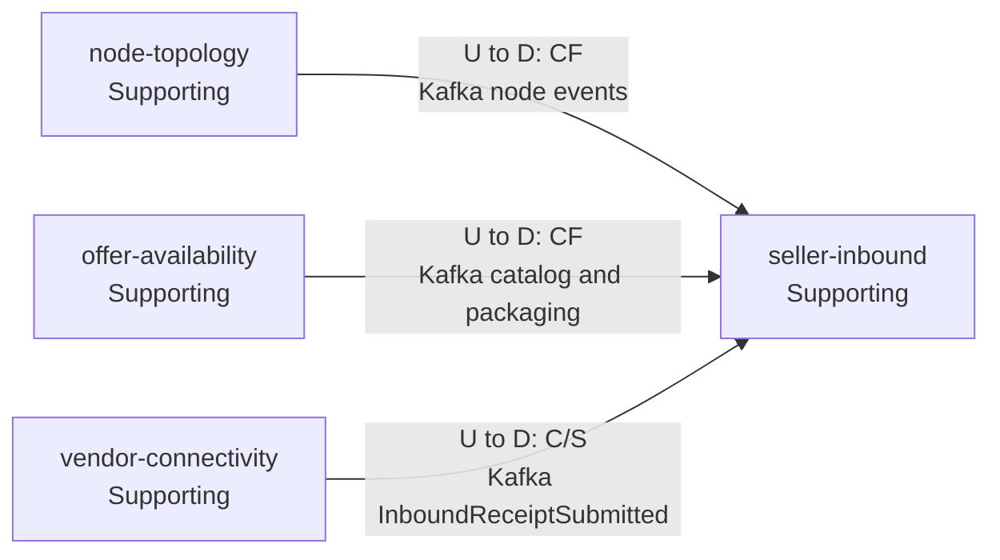
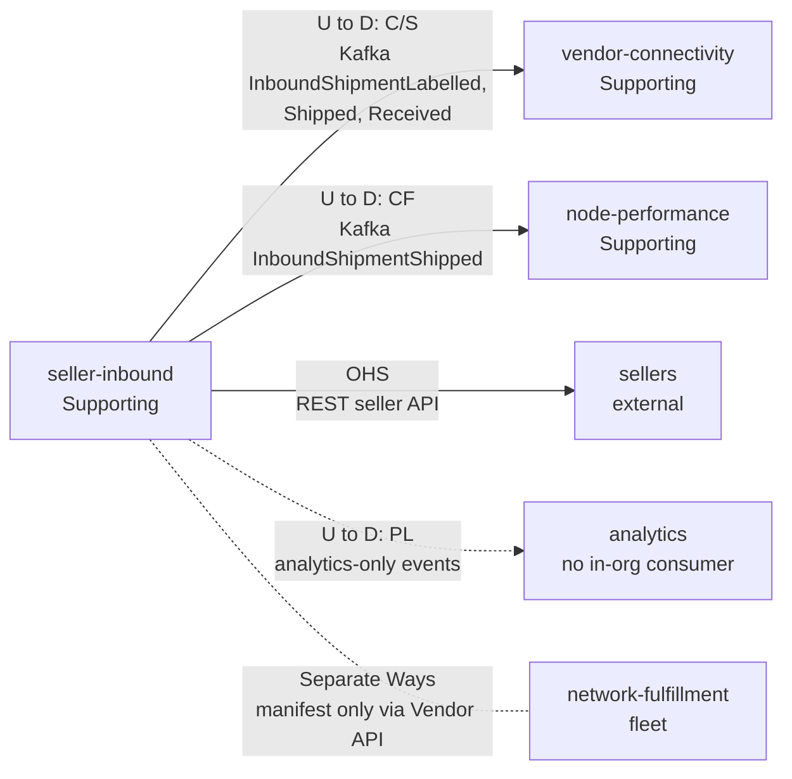

# Context Map

Following ddd-crew [Context Mapping](https://github.com/ddd-crew/context-mapping). This is seller-inbound's slice of the
[network-wide context map](https://iqvo.github.io/warehouse-docs/network/strategic-design/context-map). Arrows point from
upstream to downstream.

### Upstream: what seller-inbound conforms to

Source: `internal/adapters/inbound/kafka/consumers.go` (topics and types consumed).

### Downstream: who depends on seller-inbound

Source: `internal/adapters/outbound/kafka/encoder.go` (topic routing), `internal/adapters/inbound/http/server.go` (REST),
`apis/asyncapi.yaml`.

Omitted: the contexts with no edge to this one, which are Separate Ways: `delivery-promise`, `customer-ordering`,
`order-sourcing`, `linehaul-transportation`, `last-mile-delivery`, `shipping-and-tracking`. The service also exposes a
read-only MCP server and A2A agent ([API reference](/docs/api-reference)); they add no relationship.

## Relationships

| Neighbour | Direction | Pattern | Channel | Messages | Why this pattern |
| --- | --- | --- | --- | --- | --- |
| `node-topology` | U → D | Conformist | Kafka `retailnetwork.node-topology.events` | `NodeRegistered`, `NodeOperationalProfileDeclared`, `NodeActivated`, `NodeSuspended`, `NodeRetired` | A node's status, capabilities and inbound limits are node-topology's facts. Kept in `node_inbound_views`. |
| `offer-availability` | U → D | Conformist | Kafka `retailnetwork.offer-availability.events` | `CatalogItemPackagingDeclared`, `CatalogItemPackLevelRetired` | The packaging hierarchy and its GTINs are the catalogue's. Kept in `catalog_pack_levels`. |
| `vendor-connectivity` | U → D (SI downstream) | Customer/Supplier | Kafka `retailnetwork.vendor-connectivity.events` | `InboundReceiptSubmitted` | The receipt shape is the published language; seller-inbound states what it needs. |
| `vendor-connectivity` | U → D (SI upstream) | Customer/Supplier | Kafka `retailnetwork.seller-inbound.events` | `InboundShipmentLabelled`, `InboundShipmentShipped`, `InboundShipmentReceived` | The Vendor API needs the manifest and the closing status; seller-inbound publishes what it needs. |
| `node-performance` | U → D (SI upstream) | Conformist (node-performance conforms) | Kafka `retailnetwork.seller-inbound.events` | `InboundShipmentShipped` | The shipped instant starts the inbound timeliness metric; node-performance keeps what it needs. |
| Sellers (external) | U → D | Open Host Service | REST (seller-facing, no auth) | plans, shipments, cartons, labels | A published, versionable seller API. |
| Analytics | U → D | Published Language | Kafka `retailnetwork.seller-inbound.analytics` | six analytics-only events | No consumer inside the organisation. |
| `network-fulfillment` (warehouse-systems fleet) | none | Separate Ways | none | none | The hard boundary: the fleet reads the manifest through the Vendor API of vendor-connectivity only. |

## Notes on the patterns

- **No Shared Kernel.** `sscc`, `gtin` and `nodeId` are values copied from events; the GTIN and SSCC validation rules
  are re-implemented in each service that receives them (here `internal/domain/shared/gs1`).
- **Customer/Supplier in both directions with vendor-connectivity, by events only.** There is no runtime cycle.
- **No synchronous call.** A plan against a cold read model is refused, not slowed
  ([Integration](/docs/ecosystem/integration)).
