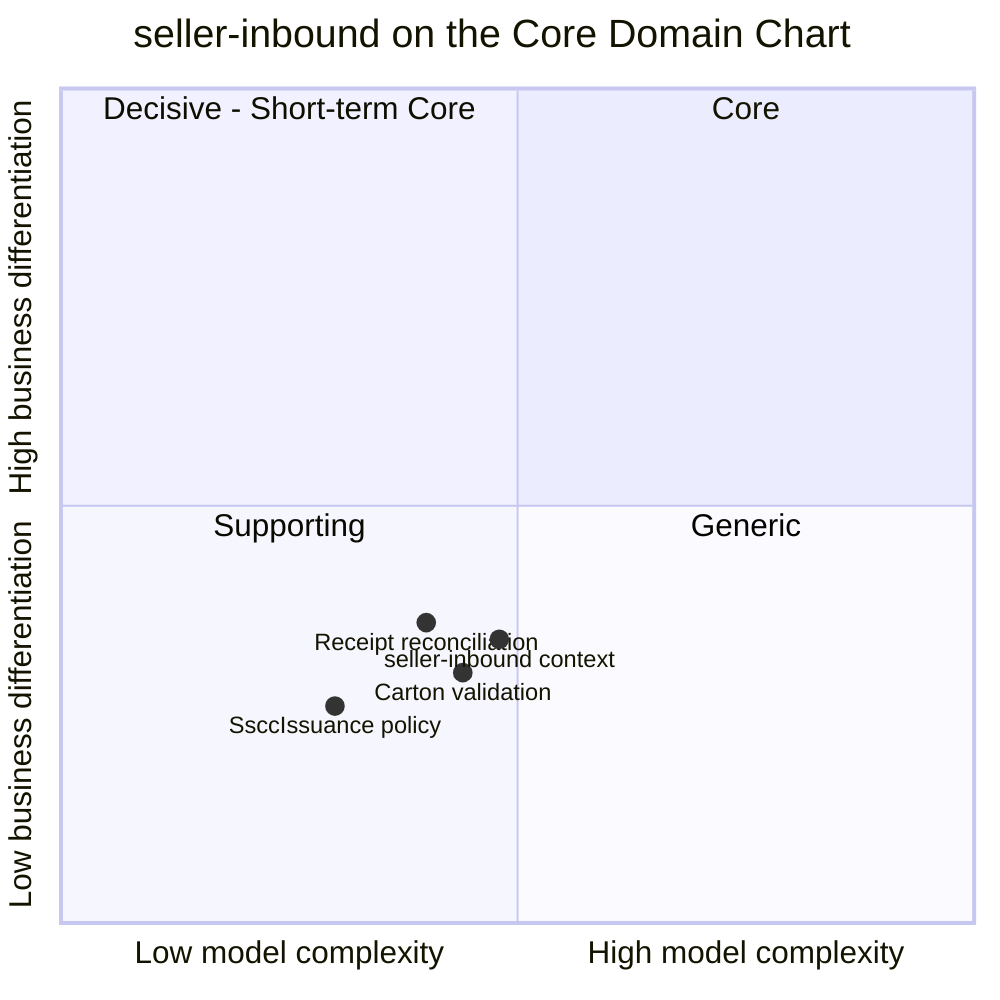

# Core Domain Chart

Following the ddd-crew [Core Domain Charts](https://github.com/ddd-crew/core-domain-charts): business differentiation (y)
against model complexity (x).

Source: the context point (0.48, 0.34) is the model's (`network/model/model.yaml`, `contexts[seller-inbound].chart`);
the three slices are placed on the retail-network pack page. The slices correspond to
`internal/domain/inboundshipment/carton.go` (carton validation), `internal/adapters/outbound/sscc/sscc.go` (SSCC
issuance) and `internal/domain/inboundshipment/receipt.go` (receipt reconciliation). The other ten contexts are on the
[network-wide chart](https://iqvo.github.io/warehouse-docs/network/strategic-design/core-domain-chart).

## Classification: Supporting

The context sits at complexity 0.48, differentiation 0.34: **quadrant 3, Supporting**, close to the complexity line.

**Differentiation is low (y = 0.34).** The rules are the common practice of case-packed receiving: identify every carton,
check it against the plan, count what arrives. Nothing here decides a promise or a route, which is what sets the network
apart. It enables supply; it does not differentiate.

**Model complexity is moderate (x = 0.48).** Three aggregates, one with a child entity (`Carton`) and a six-state
machine, eight consumed event types from three producers, and invariants that depend on two local read models
(`NodeInboundView`, `CatalogPackagingView`). The hardest part is validating a carton set against a plan and a packaging
hierarchy, not the lifecycle.

| Axis | Verdict |
| --- | --- |
| **Business model** | Supply enabler: seller stock arrives planned, labelled, countable and attributable to its owner. |
| **Evolution** | Custom-built. Buying a seller-onboarding product would still leave the carton and receipt rules to write. |

## Why it is its own context

1. **It is the seller's contract, not the vendor's.** vendor-connectivity is the vendor protocol (purchase orders,
   acknowledgements). Seller plans and cartons have a different actor, lifecycle and clock.
2. **It owns facts nobody else should.** SSCC uniqueness network-wide and the plan-to-cartons reconciliation have no other
   natural home.
3. **It keeps the seam narrow.** Sellers reach this context; vendors reach vendor-connectivity; the two meet only through
   events.

**Movement to watch.** If seller compliance became a scored, enforced programme, the Enforcer role would grow and the
context would move up. The scorecard the service has today is informational and acts on nothing
([ADR 0005](/docs/adr/0005-seller-compliance-scorecard)); see
[Subdomain classification](/docs/ddd/subdomain-classification).
