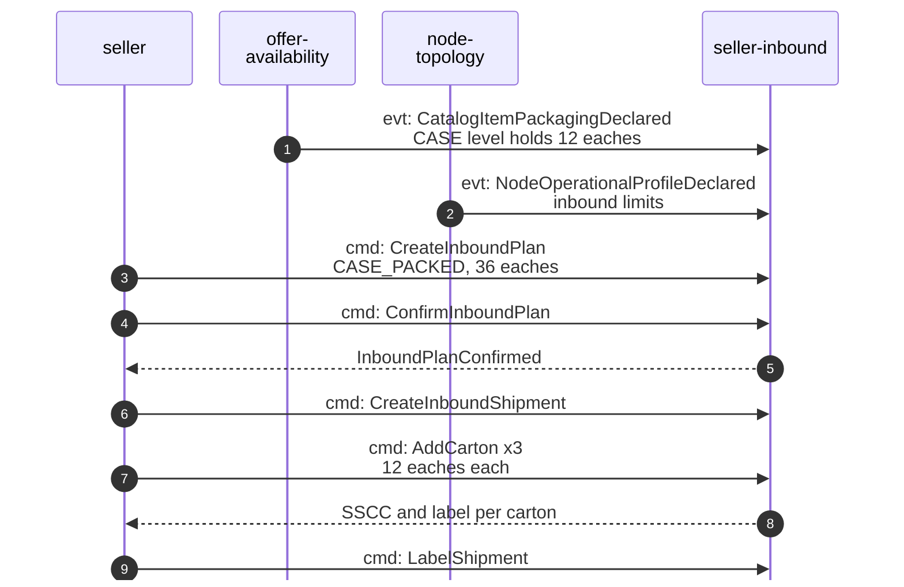
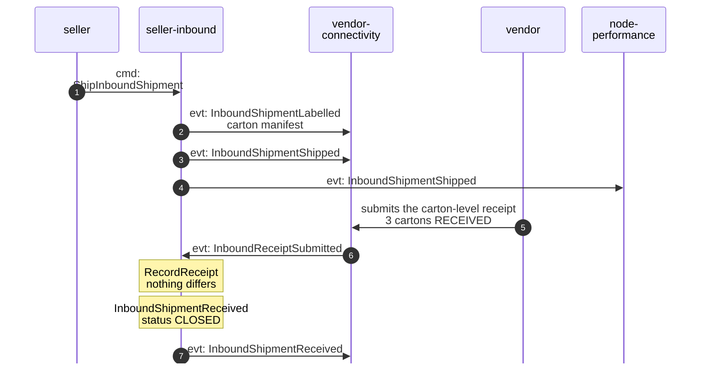
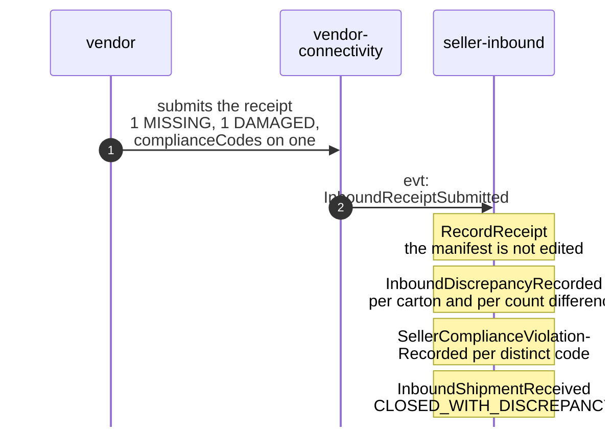
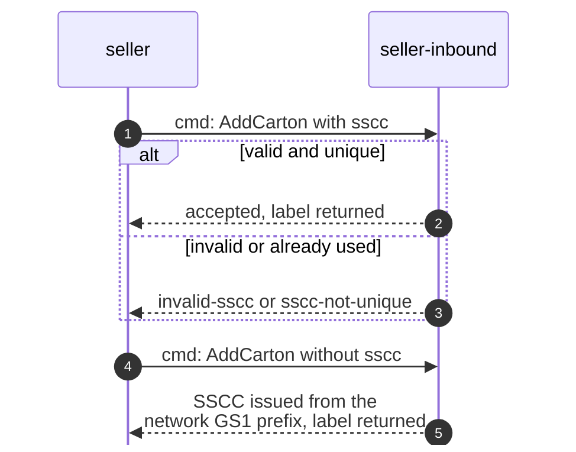

# Domain Message Flow

Following ddd-crew [Domain Message Flow Modelling](https://github.com/ddd-crew/domain-message-flow-modelling). Every arrow
is a message of this context, prefixed `cmd:`, `evt:` or `qry:`. Quantities and identifiers in the notes are illustrative.
Full event types are on [Domain events](/docs/ddd/domain-events); the runtime view with errors is on
[Sequence diagrams](/docs/ddd/sequence-diagrams). The vendor-side steps (the vendor polling and submitting through the
Vendor API) belong to vendor-connectivity and are shown only as far as they reach this context.

## 1. A case-packed shipment, plan to close

### 1a. Plan and pack

Source: `internal/adapters/inbound/kafka/consumers.go` (the two views), `internal/application/usecases/{plans,shipments}.go`.

### 1b. Ship and receive

Source: `internal/application/usecases/shipments.go` (`ShipInboundShipment`), `consumers.go` (`ApplyInboundReceipt`),
`internal/adapters/outbound/kafka/encoder.go` (topic routing).

## 2. A receipt with a discrepancy

Source: `internal/domain/inboundshipment/receipt.go` (`RecordReceipt`, `statusDiscrepancy`, `quantityDiscrepancies`,
`violations`).

## 3. SSCC issuance

Source: `internal/application/usecases/shipments.go` (`addWithSSCC`), `internal/adapters/outbound/sscc/sscc.go`,
`internal/domain/inboundshipment/carton.go` (`checkSSCCs`).
