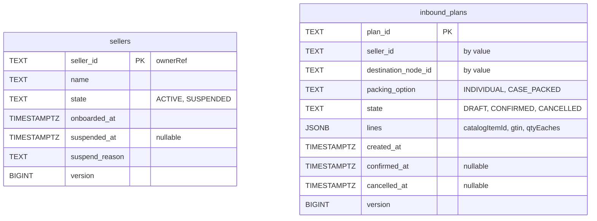
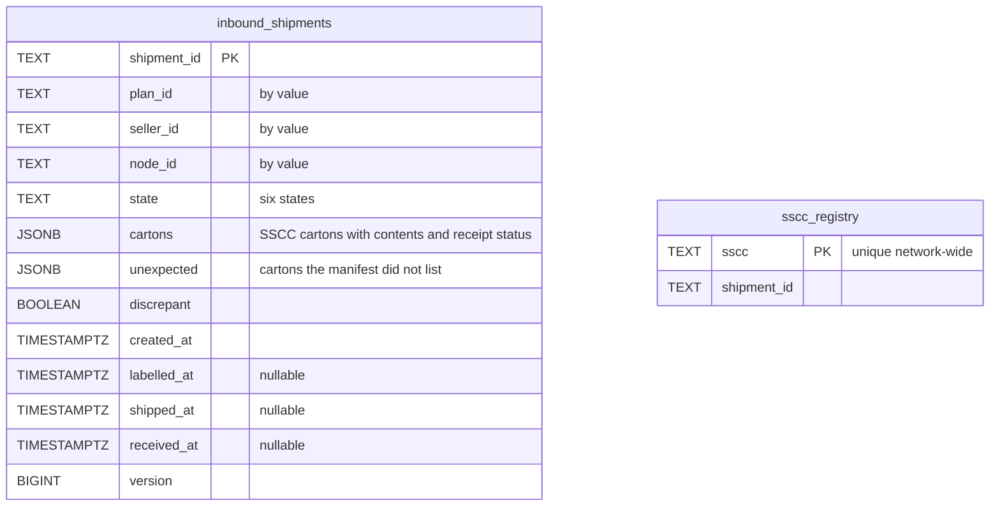
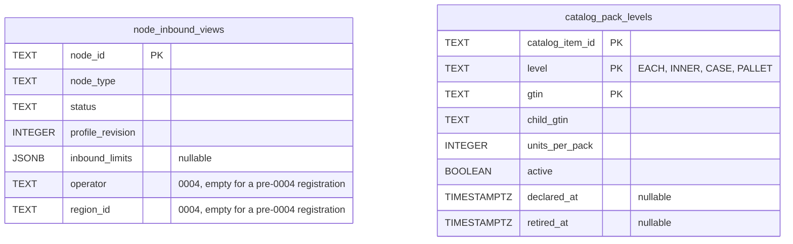
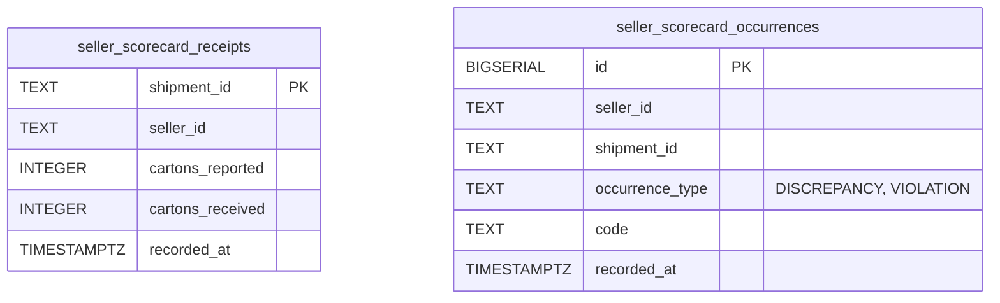
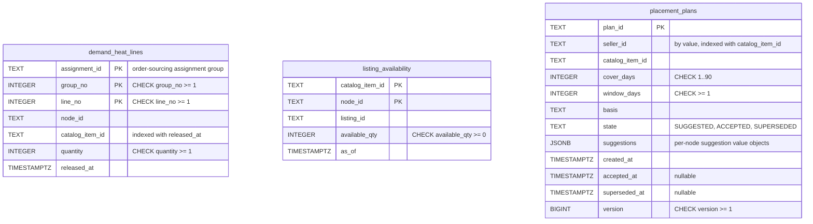
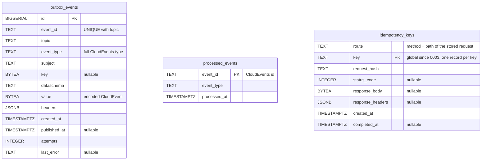

# Entity Relationship

The schema of this context's own Postgres database, as created by
`internal/adapters/outbound/postgres/migrations/0001_seller_inbound_schema.up.sql`, `0002_seller_scorecard.up.sql`,
`0003_idempotency_key_global.up.sql` and `0004_placement_advisory.up.sql`.
There are no foreign keys: each aggregate is one row, and the parts drawn as child entities (plan lines, cartons and
their contents) are stored as `JSONB` on that row. Ids of other aggregates are held by value. The `sscc_registry` table
holds network-wide SSCC uniqueness ([ADR 0002](/docs/adr/0002-aggregates-and-invariants)). Fourteen tables (nine in 0001,
two in 0002, three in 0004; 0003 only narrows the primary key of `idempotency_keys`) and one sequence, `sscc_serial_seq`, which supplies the serial of every SSCC the network issues.

Seller and plan aggregates:

Shipment aggregate and the SSCC registry:

Read models fed by consumed events:

Seller scorecard facts (migration 0002, [ADR 0005](/docs/adr/0005-seller-compliance-scorecard)), written in the same unit
of work as the receipt:

Placement advisory (migration 0004, [ADR 0012](/docs/adr/0012-the-placement-advisory)): the two halves of the
`DemandHeatView` read model and the `PlacementPlan` aggregate:

`demand_heat_lines` holds one row per live released line of an assignment group (a later release of the group replaces
its rows, `FulfillmentCancelled` deletes them) and `listing_availability` the latest `ListingAvailabilityChanged` per
item and node. The `placement_plans` suggestions are value objects stored as `JSONB`. Nothing in the running `cmd/api`
writes `demand_heat_lines` yet; see [Integration](/docs/ecosystem/integration#upstream-what-seller-inbound-consumes).

Outbox, inbox and idempotency (infrastructure tables):

Source: the four migrations above. The idempotency rows are purged after 24 hours by the retention sweep in `cmd/api`
(see [Runbook](/docs/operations/runbook)). Check constraints (`state`, `packing_option`, `level`, `occurrence_type`,
`version >= 1`, `cartons_received <= cartons_reported`) are in the migrations. Column details of the outbox and
consumer behaviour are on [Troubleshooting](/docs/operations/troubleshooting).
