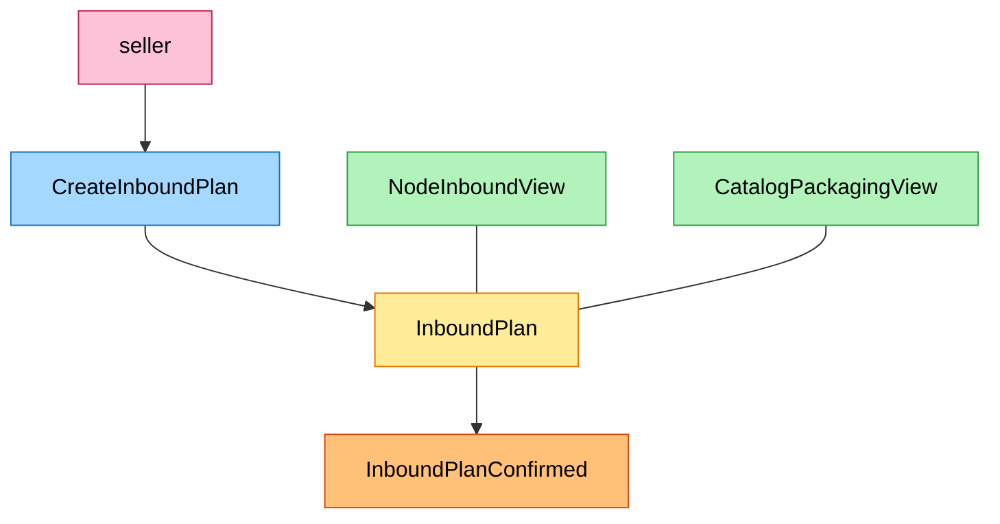
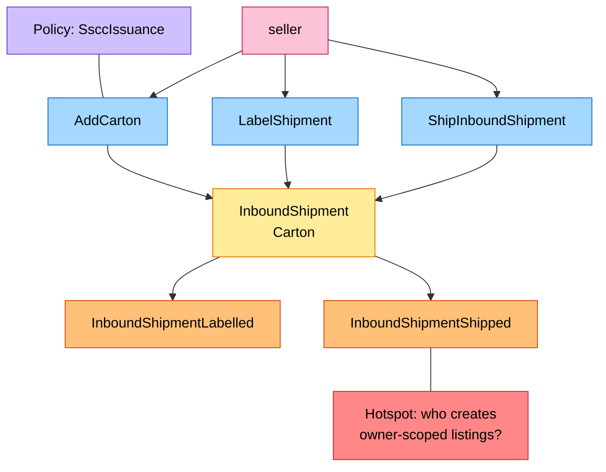
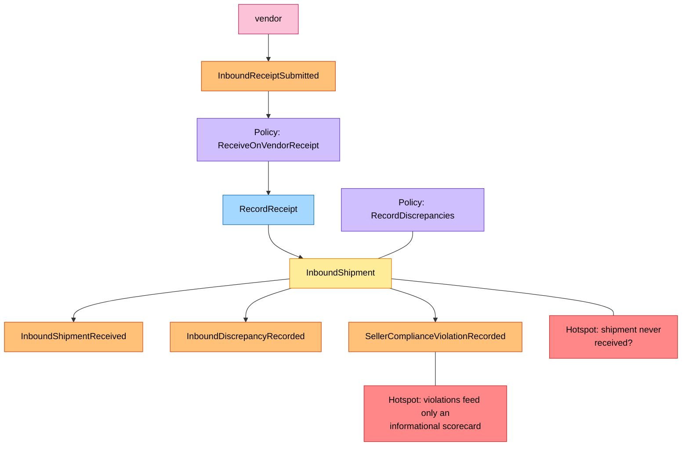

# EventStorming

Process-level boards in the ddd-crew [EventStorming glossary & cheat sheet](https://github.com/ddd-crew/eventstorming-glossary-cheat-sheet)
notation. Every sticky is a command, aggregate, event, policy or read model that exists in the code; the hotspots are the
open questions of the network gap register (IQVO/warehouse-docs) and of this repository's ADRs. The network-wide board is
[EventStorming big picture](https://iqvo.github.io/warehouse-docs/network/strategic-design/eventstorming-big-picture).

| Sticky | Colour | Meaning here |
| --- | --- | --- |
| Command | blue `#a5d8ff` | `CreateInboundPlan`, `AddCarton`, `LabelShipment`... |
| Aggregate | yellow `#ffec99` | `InboundPlan`, `InboundShipment` |
| Domain Event | orange `#ffc078` | an event published or consumed |
| Policy | lilac `#d0bfff` | a rule applied by a use case |
| Read Model | green `#b2f2bb` | `NodeInboundView`, `CatalogPackagingView` |
| External System | pink `#fcc2d7` | another context or an actor |
| Hotspot | red `#ff8787` | an open question |

## 1. Plan and confirm

Source: `internal/application/usecases/plans.go`. `NodeInboundView` is read at creation and confirmation (`requireNode`);
`CatalogPackagingView` is read later, on `AddCarton`. The event appears on confirmation (`ConfirmInboundPlan`), not on
creation.

## 2. Pack, label, ship

Source: `internal/application/usecases/shipments.go`, `internal/domain/inboundshipment/{shipment,carton}.go`.

## 3. Receipt and reconciliation

Source: `internal/application/usecases/consumers.go` (`ApplyInboundReceipt`), `internal/domain/inboundshipment/receipt.go`.

## Hotspots

| Hotspot | Where it comes from |
| --- | --- |
| Who creates owner-scoped listings from received stock | Network gap register G51 (IQVO/warehouse-docs): nothing in this service creates a listing |
| A shipped shipment that is never received | No timeout exists: a `SHIPPED` shipment stays so until a receipt arrives (see [Troubleshooting](/docs/operations/troubleshooting)) |
| Violations are recorded and nothing acts on them | The scorecard is informational ([ADR 0005](/docs/adr/0005-seller-compliance-scorecard)); no consumer of the analytics topic exists in the organisation |
