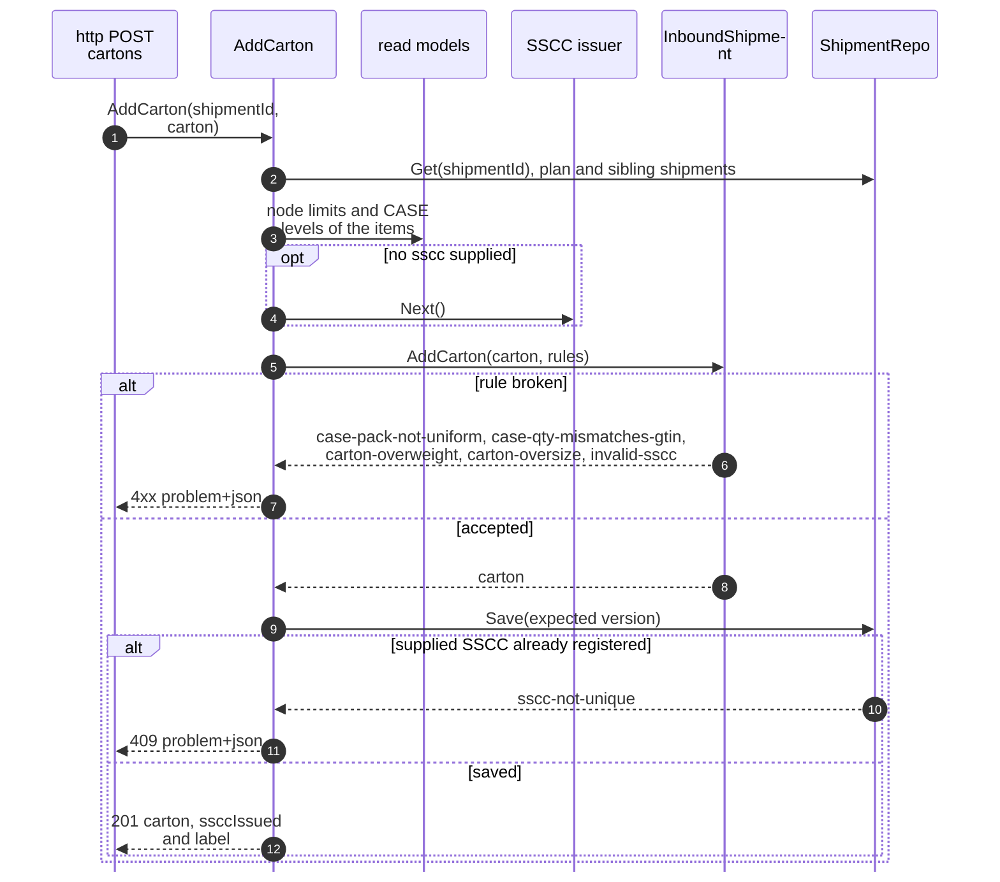
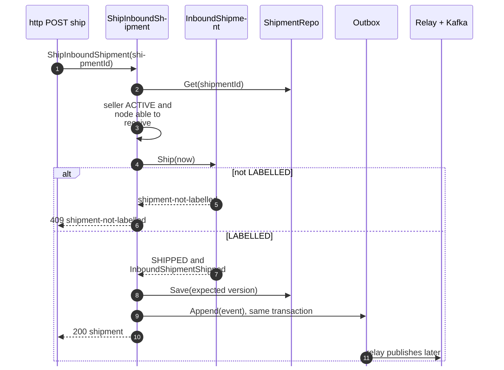
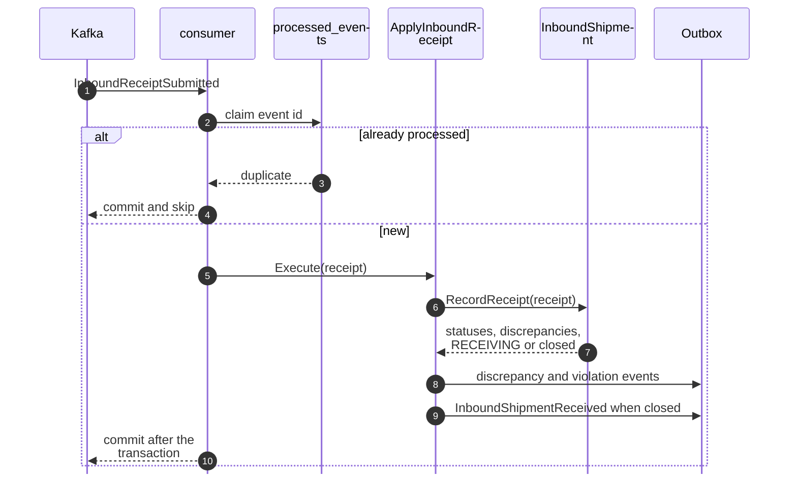
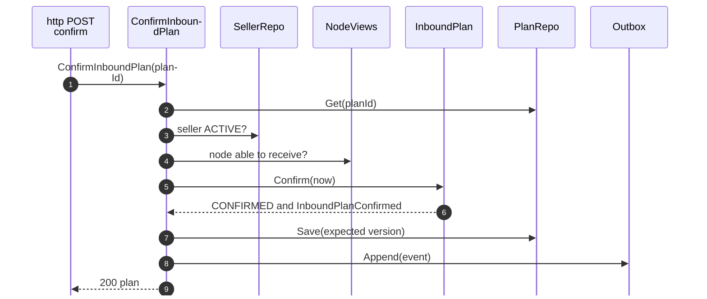

# Sequence Diagrams

Shared conventions, from the code:

- Every use case runs inside `Service.atomically`, one Postgres transaction (`UnitOfWork`). The repository saves with
  `WHERE version = :expected`; a lost race is `concurrent-update` (409).
- Outbox rows are written in the same transaction as the aggregate (`EventOutbox.Append`); the in-process relay produces
  them to Kafka later (`retailnetwork.seller-inbound.events`; the six analytics-only events to
  `retailnetwork.seller-inbound.analytics`).
- Write routes pass the HTTP idempotency middleware first (`Idempotency-Key`); it is omitted from the diagrams.
- Consumers claim the CloudEvents `id` in `processed_events` in the same transaction as their effect.
- Event names are short; full types are on the [Event catalogue](/docs/api-reference/events).

## 1. AddCarton

Source: `internal/application/usecases/shipments.go` (`AddCarton`, `addWithSSCC`). An issued SSCC that collides is
re-issued up to `SsccIssueAttempts` times; a supplied one that collides is the seller's error. No event is written.

## 2. ShipInboundShipment

Source: `shipments.go` (`ShipInboundShipment`). The outcome is counted on `seller_inbound.shipment.shipped`
(`outcome` `shipped` or `rejected`, `reason` the problem slug); see [Observability](/docs/operations/observability).

## 3. ApplyInboundReceipt (consumer)

Source: `internal/adapters/inbound/kafka/consumer.go`, `internal/application/usecases/consumers.go`,
`internal/domain/inboundshipment/receipt.go`. A receipt for a shipment that is already closed is a no-op; the scorecard
facts are written in the same transaction as the receipt.

## 4. Confirm a plan

Source: `internal/application/usecases/plans.go` (`ConfirmInboundPlan`, `requireNode`). A refusal maps to
`seller-suspended`, `node-cannot-receive` or `illegal-transition`.
