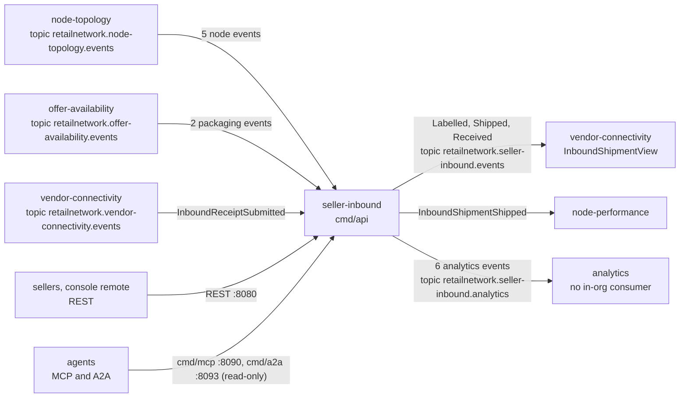

# Integration

seller-inbound talks to its neighbours through Kafka and its own interfaces only. It makes **no synchronous call to
any sibling context** (no REST, MCP or A2A client): the chart has no `*Url` keys, the A2A adapter is pinned
read-only with no outbound client (`TestA2AAgentIsReadOnlyAndHasNoOutboundClient`), and the node and packaging facts it
needs arrive as events into local tables ([ADR 0003](/docs/adr/0003-consumed-contracts-and-local-read-models)). A plan
made against a table that has not caught up is refused, not slowed.

Contracts: `apis/asyncapi.yaml` for events, `apis/openapi.yaml` for REST. Every message is CloudEvents 1.0 in structured
mode, built and decoded only in `internal/adapters/kafka/cloudevents`; the type is
`com.retailnetwork.<tier>.<context>.<entity>.<EventName>` and the Kafka key is the subject (the aggregate id).

Source: `internal/adapters/inbound/kafka/consumers.go`, `internal/adapters/outbound/kafka/encoder.go`,
`apis/asyncapi.yaml`, and the consumer settings in `warehouse-infra` `helm-values/vendor-connectivity.yaml` and
`node-performance.yaml`.

## Upstream: what seller-inbound consumes

Three consumers run in `cmd/api`, each under a mandatory stable consumer group ([Runbook](/docs/operations/runbook)).
Each message is claimed in `processed_events` by its CloudEvents id in the same transaction as its effect, so delivery
is at-least-once with an atomic effect.

| Producer | Topic | Event types consumed | Effect |
| --- | --- | --- | --- |
| node-topology | `retailnetwork.node-topology.events` | `com.retailnetwork.logistics.node-topology.node.NodeRegistered`, `NodeOperationalProfileDeclared`, `NodeActivated`, `NodeSuspended`, `NodeRetired` | Folded into `node_inbound_views`: node type, status and inbound limits (`maxCartonWeightG`, `maxCartonDims`, `acceptsPallets`, `requiresSscc`). |
| offer-availability | `retailnetwork.offer-availability.events` | `com.retailnetwork.commerce.offer-availability.catalogitem.CatalogItemPackagingDeclared`, `CatalogItemPackLevelRetired` | Folded into `catalog_pack_levels` (item, level, GTIN, units per pack, active flag). |
| vendor-connectivity | `retailnetwork.vendor-connectivity.events` | `com.retailnetwork.partner.vendor-connectivity.inboundreceipt.InboundReceiptSubmitted` | Applied to the shipment: closes it and records discrepancies and compliance violations ([Use cases](/docs/ddd/use-cases)). |

Payloads are decoded tolerantly: unknown fields are ignored, and a type this consumer has no handler for is committed
past without a log line.

**Failure behaviour (all three consumers).** The offset is committed only after the effect committed. A transient
failure (database error) is retried with capped exponential backoff, 200 ms doubling to 5 s, up to 5 attempts, then the
message goes to `<topic>.dlq` with the headers `x-dlq-source-topic`, `x-dlq-source-partition`, `x-dlq-source-offset`,
`x-dlq-error` and `x-dlq-failed-at`. A message that can never be applied is dead-lettered at once: not a valid
CloudEvent is skipped and logged at WARN; an undecodable payload, a value the domain refuses, an illegal transition, or a
receipt for a shipment this service does not know are dead-lettered. The dead-letter publish is itself retried forever,
so a message is never dropped. A lost broker connection is retried up to 10 consecutive times, then the consumer ends and
the process exits non-zero so the orchestrator restarts it. Out-of-order node and packaging events are tolerated (see
[Use cases](/docs/ddd/use-cases)).

**Cold start.** Until node-topology has published a node as `ACTIVE`, plans for it are refused `node-cannot-receive`;
until offer-availability has published a CASE level, a case-packed carton for that item is refused
`case-qty-mismatches-gtin`. There is no live lookup to fall back on.

## Downstream: what seller-inbound publishes

Events are written to `outbox_events` in the same transaction as the aggregate and relayed to Kafka by the in-process
relay (`OUTBOX_RELAY_INTERVAL`, rows retried up to `OUTBOX_MAX_ATTEMPTS`). Writers use `RequiredAcks: all` and auto-create
the topic on first write; delivery is at-least-once with a stable id. See [Events](/docs/api-reference/events) for every
payload.

| Topic | Events | Known consumers |
| --- | --- | --- |
| `retailnetwork.seller-inbound.events` | `InboundShipmentLabelled`, `InboundShipmentShipped`, `InboundShipmentReceived` | vendor-connectivity (builds the `InboundShipmentView` it serves on the Vendor API); node-performance (`InboundShipmentShipped`, the start of its inbound timeliness metric) |
| `retailnetwork.seller-inbound.analytics` | `SellerOnboarded`, `SellerSuspended`, `SellerReinstated`, `InboundPlanConfirmed`, `InboundDiscrepancyRecorded`, `SellerComplianceViolationRecorded` | none in the organisation (published for analytics only) |

The consumer groups of the downstream services are in `warehouse-infra` (`node-performance-seller-inbound` for
node-performance; vendor-connectivity's values comment names the same stream). If Kafka is down the writes are still
accepted and the events wait in the outbox.

## Interfaces it exposes

| Interface | Binary | Address | Consumers |
| --- | --- | --- | --- |
| REST seller API | `cmd/api` | `:8080`; Kong route `/api/seller-inbound` with the prefix stripped (`warehouse-infra`) | sellers, the console remote `seller_inbound_mfe` (`web/`, served at `/mfes/seller-inbound/`) |
| MCP (read-only, Streamable HTTP) | `cmd/mcp` | `:8090`, `/mcp`; Kong route `/api/mcp/seller-inbound` | the warehouse ops agent (`http://seller-inbound-mcp.warehouse-systems.svc.cluster.local:8090/mcp`) |
| A2A (read-only, JSON-RPC 2.0) | `cmd/a2a` | `:8093`, `/` and `/a2a`; Agent Card `/.well-known/agent-card.json`; Kong route `/api/a2a/seller-inbound` | any delegating agent |

All three are unauthenticated. See [API reference](/docs/api-reference) and [MCP tools](/docs/mcp/tools).

## Edges that do not exist

- **The warehouse-systems fleet.** The `network-fulfillment` side never calls this context and never consumes its
  topics. Per the design the fleet reads a shipment's carton manifest through the Vendor API of vendor-connectivity only
  (README and `CLAUDE.md`: this service belongs to the retail network, not to the fleet). Nothing in this repository
  references a fleet service.
- **The vendor.** A vendor never calls seller-inbound; its carton-level receipt reaches this service only as
  `InboundReceiptSubmitted` from vendor-connectivity. The OpenAPI contract says the same.
- **Synchronous reads of node-topology or offer-availability.** None: local read models only.
- **Outbound A2A or MCP clients.** None. This context is delegated to and never delegates.
- **Payments, freight, placement advice, EDI.** Not modelled; there is no integration to them.
- **Downstream consumers of the analytics topic.** None inside the organisation.
- **Item liveness.** `CatalogItemCreated` and `CatalogItemDiscontinued` are not consumed, so a plan line is not checked
  against whether the item is live.

## Discrepancies found

- `internal/adapters/inbound/kafka/kafka.go` and `deadletter.go` still mention order-sourcing's
  `FulfillmentReleasedToNode` and `FulfillmentCancelled` and a `retailnetwork.order-sourcing.events.dlq` example in their
  comments. The code consumes no order-sourcing topic.
- The OpenAPI `servers` URL is `http://localhost:8000/api/retail-network/seller-inbound`, but the gateway route in
  `warehouse-infra` is `/api/seller-inbound`.
