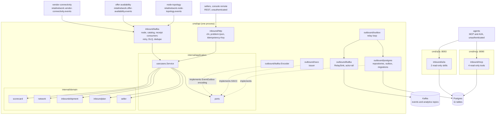

# Architecture

seller-inbound follows the fleet's hexagonal (ports and adapters) layout: dependencies point inward, the domain imports
nothing from the rest of the module, and only `cmd/` wires the layers together. Everything on this page is on `develop`.

## Layout

| Layer | Path | Role |
| --- | --- | --- |
| Domain | `internal/domain/seller` | `SellerAccount` aggregate (`ACTIVE` or `SUSPENDED`), events `SellerOnboarded`, `SellerSuspended`, `SellerReinstated`. |
| Domain | `internal/domain/inboundplan` | `InboundPlan` aggregate (`DRAFT`, `CONFIRMED`, `CANCELLED`), event `InboundPlanConfirmed`. |
| Domain | `internal/domain/inboundshipment` | `InboundShipment` aggregate with `Carton` entities (six states), the receipt reconciliation, and the events `InboundShipmentLabelled`, `InboundShipmentShipped`, `InboundShipmentReceived`, `InboundDiscrepancyRecorded`, `SellerComplianceViolationRecorded`. |
| Domain | `internal/domain/network` | The two local read-model rows: `Node` (`NodeInboundView`) and `PackLevel` (`CatalogPackagingView`), folded from neighbours' events. |
| Domain | `internal/domain/scorecard` | The pure computation of the seller compliance scorecard from recorded facts. |
| Domain | `internal/domain/shared`, `shared/gs1` | `ErrValidation`, `ErrIllegalTransition`; GS1 GTIN, SSCC and element-string parsing with mod-10 check digits. |
| Application | `internal/application/usecases` | One method of `Service` per command, query or consumed event ([Use cases](/docs/ddd/use-cases)). |
| Application | `internal/application/{ports,requests,views,outbox}` | The out ports (`SellerRepository`, `PlanRepository`, `ShipmentRepository`, `NodeViewRepository`, `PackagingViewRepository`, `ScorecardFacts`, `EventOutbox`, `ProcessedEvents`, `UnitOfWork`, `Clock`, `IDGenerator`, `SsccIssuer`, `ShipmentMetrics`), the request and view structs, and the already-encoded outbox `Message`. |
| Inbound adapter | `internal/adapters/inbound/http` | chi router for `apis/openapi.yaml`: handlers, problem mapping (`errors.go`), the `Idempotency-Key` middleware, `/healthz`, `/readyz`. No auth middleware. |
| Inbound adapter | `internal/adapters/inbound/kafka` | The node, catalog and receipt consumers: CloudEvents decode, dispatch on the full `type`, retry with backoff, dead-letter topic, consumer span. |
| Inbound adapter | `internal/adapters/inbound/mcp` | The four read-only MCP tools. |
| Inbound adapter | `internal/adapters/inbound/a2a` | The two read-only A2A skills and the Agent Card. |
| Inbound adapter | `internal/adapters/inbound/requestlog` | The access-log middleware shared by the three routers. |
| Outbound adapter | `internal/adapters/outbound/postgres` | pgxpool repositories, unit of work (`pgtx`), outbox repository, scorecard facts, embedded migrations. |
| Outbound adapter | `internal/adapters/outbound/kafka` | `Encoder` (domain event to CloudEvents outbox message), `NewWriter`, `RelaySink`, `BrokerCheck` (the Kafka half of `/readyz`). |
| Outbound adapter | `internal/adapters/outbound/outbox` | The relay loop that drains `outbox_events`. |
| Outbound adapter | `internal/adapters/outbound/sscc` | The SSCC issuer over the Postgres sequence `sscc_serial_seq`. |
| Outbound adapter | `internal/adapters/outbound/telemetry` | OpenTelemetry setup, the `seller_inbound.shipment.shipped` counter, the trace-correlating slog handler. |
| Outbound adapter | `internal/adapters/outbound/{clock,ids}` | `Clock` and id generation (`pln-`, `shp-` prefixes). |
| Outbound adapter | `internal/adapters/outbound/memory` | In-memory implementation of the ports: a **test double** for the unit and BDD suites. No `cmd/**` binary imports it (`TestRuntimeBinaryHasNoInMemoryAdapters`). |
| Kafka envelope | `internal/adapters/kafka/cloudevents` | The only place a CloudEvents 1.0 envelope is built or decoded. |
| Support | `internal/bootretry` | Exponential-backoff retry for the first outbound dials at boot. |
| Composition roots | `cmd/api`, `cmd/mcp`, `cmd/a2a` | See below. |
| Test support | `internal/testing/{kafkatest,pgtest}` | Shared testcontainers helpers. |
| Fitness tests | `internal/architecture` | arch-go and source-scanning tests. |

The out ports are interfaces in `internal/application/ports/ports.go`; the SSCC issuer, the clock, id generation and the
shipment counter are ports too, so the use cases never touch infrastructure.

## Binaries and ports

| Binary | Role | Port | Probes |
| --- | --- | --- | --- |
| `cmd/api` | REST API, the node, catalog and receipt consumers, the outbox relay and the retention sweeper in one process, all always on, on real Postgres and Kafka. Files: `main.go` (run and shutdown order), `config.go` (env parsing, `loadRuntime`), `wire_adapters.go`, `wire_background.go`, `telemetry.go`. | `HTTP_ADDR`, default `:8080` | `GET /healthz` (liveness), `GET /readyz` (drain gate, Postgres ping, a Kafka broker answers a metadata request; never topics) |
| `cmd/mcp` | Read-only MCP server (Streamable HTTP) over the read use cases; no relay, consumer or Kafka ([ADR 0006](/docs/adr/0006-read-only-mcp-server)). | `MCP_ADDR`, default `:8090` | `GET /healthz` |
| `cmd/a2a` | Read-only A2A (Agent2Agent) agent: JSON-RPC 2.0 at `/` and `/a2a`, Agent Card at `/.well-known/agent-card.json`; no relay, consumer or Kafka ([ADR 0009](/docs/adr/0009-a2a-inbound-adapter)). | `A2A_ADDR`, default `:8093` | `GET /healthz` |

`web/` is not a Go binary: it is the `seller_inbound_mfe` Module Federation remote (Vite and React) shipped in its own
nginx image ([ADR 0007](/docs/adr/0007-console-web-remote)). There is no projector, reports or analytical-database
binary. How `cmd/api` boots and stops is in [Runtime](/docs/overview/runtime); every variable is in
[Configuration](/docs/operations/configuration).

## Container diagram

Source: `cmd/api/{main,wire_adapters,wire_background}.go` (wiring and workers), `cmd/mcp/main.go`, `cmd/a2a/main.go`,
`internal/application/ports/ports.go` (the out ports), `internal/adapters/outbound/postgres/repositories.go`,
`internal/adapters/outbound/kafka/encoder.go`, `internal/adapters/outbound/outbox/relay.go` and
`internal/architecture/architecture_test.go`. The in-memory adapters are not in the diagram because no binary wires them.
`cmd/mcp` and `cmd/a2a` run the same embedded migrations at boot and read through the same repositories.

## Data stores

One Postgres database owned by this context, created by the embedded migrations
(`internal/adapters/outbound/postgres/migrations/`: `0001_seller_inbound_schema`, `0002_seller_scorecard`):

| Table | Holds |
| --- | --- |
| `sellers` | The `SellerAccount` aggregate: state, name, suspension, `version`. |
| `inbound_plans` | The `InboundPlan` aggregate; the lines live in JSONB. |
| `inbound_shipments` | The `InboundShipment` aggregate; its cartons and the unexpected SSCCs are JSONB (a shipment is always read and written whole). |
| `sscc_registry` | Every carton SSCC of every shipment, unique network-wide; registered in the shipment's save transaction. |
| `node_inbound_views` | Local copy of the nodes: type, status, profile revision, inbound limits. |
| `catalog_pack_levels` | Local copy of the packaging hierarchy: item, level, GTIN, units per pack, active flag. |
| `outbox_events` | The transactional outbox; one row per message and destination topic, with `attempts` and `last_error`. |
| `processed_events` | The consumers' inbox: CloudEvents ids already applied. |
| `idempotency_keys` | Stored answers of the `POST` routes, keyed by `(route, key)`, kept 24 h. |
| `seller_scorecard_receipts`, `seller_scorecard_occurrences` | The append-only facts the scorecard is computed from. |

Plus the sequence `sscc_serial_seq`. Postgres is the only store: the binaries refuse to boot without `DATABASE_URL`
and nothing is served from process memory. Kafka is the fleet's single broker; `cmd/api` produces to
`retailnetwork.seller-inbound.events` and `retailnetwork.seller-inbound.analytics`, consumes
`retailnetwork.node-topology.events`, `retailnetwork.offer-availability.events` and
`retailnetwork.vendor-connectivity.events`, and never creates a topic through an admin API.

## Rules enforced by `internal/architecture`

The tests run on every PR (`arch-test` job, `make arch-test`); the full list is on [Testing](/docs/development/testing).
The load-bearing ones:

| Rule | Test |
| --- | --- |
| Domain depends only on domain; application only on domain and application; inbound and outbound adapters do not import each other | `TestHexagonalArchitecture` (6 subtests) |
| The MCP and A2A adapters depend only on application and domain, nothing depends on them, and they reach read use cases only | `TestMCPAdapterDependencyRule`, `TestA2AAdapterDependencyRule`, `TestA2AAgentIsReadOnlyAndHasNoOutboundClient` |
| No authentication middleware | `TestNoAuthMiddlewareReintroduced` |
| No binary imports the in-memory adapters | `TestRuntimeBinaryHasNoInMemoryAdapters` |
| CloudEvents 1.0 is the only envelope | `TestNoEventEnvelopeToggleOrFlatEnvelope`, `TestCloudEventsOnly` |
| Every outbox relay passes an attempt cap | `TestOutboxRelaysPassAttemptCap` |
